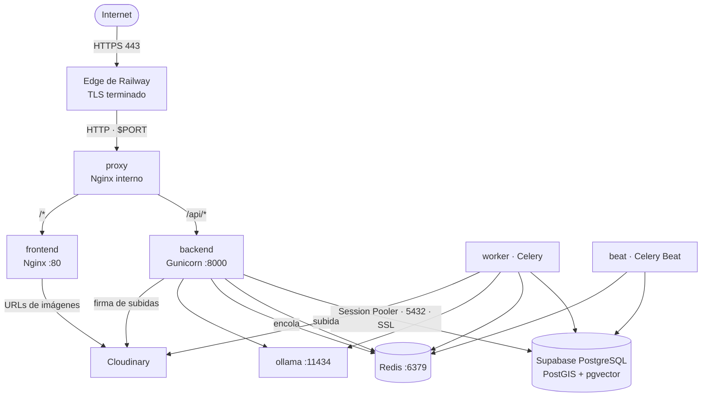

# Despliegue en Railway + Supabase — guía completa

> **Arquitectura:** Supabase aloja PostgreSQL (PostGIS + pgvector); Railway
> ejecuta el backend, worker, beat, frontend, proxy, Redis y (opcionalmente)
> Ollama. Se usan **dos proyectos Railway** (`turismo-staging` y
> `turismo-production`) y **dos proyectos Supabase** independientes.
>
> **Estado:** el repositorio está preparado para este despliegue, pero no se
> ha creado ningún proyecto. El propietario debe seguir esta guía.

## 1. Topología objetivo



- Solo **proxy** tiene dominio público. El resto vive en la red privada
  (`<servicio>.railway.internal`).
- **No se crea el servicio `db`**: la base está en Supabase.
- Railway termina TLS en el edge: no hay certbot ni certificados en Nginx.
- Ollama es un servicio privado del mismo proyecto. En staging es opcional.

## 2. Requisitos previos

| Requisito | Detalle |
|---|---|
| Plan Railway | **Hobby** o superior. Free/Trial no alcanza para volúmenes de 5 GB. |
| Supabase | Dos proyectos: staging y producción. Ver [`deploy/supabase/README.md`](../supabase/README.md). |
| Repositorio | `https://github.com/SajoriARA/proyecto-de-sistemas` |
| Imágenes | GHCR públicas (recomendado) o Docker Hub públicas. Ver §3. |
| Dominio | No hace falta dominio propio: `https://<servicio>.up.railway.app`. |
| Modelos Ollama | `embeddinggemma:300m` (768 dimensiones) y `qwen3:0.6b`. |

## 3. Imágenes

### GHCR (recomendado)

| Imagen | Uso en Railway |
|---|---|
| `ghcr.io/sajoriara/proyecto-de-sistemas-backend:<tag>` | `backend`, `worker`, `beat` |
| `ghcr.io/sajoriara/proyecto-de-sistemas-frontend:<tag>` | `frontend` |
| `ghcr.io/sajoriara/proyecto-de-sistemas-proxy:<tag>` | `proxy` |
| `ghcr.io/sajoriara/proyecto-de-sistemas-db` | **No se usa** con Supabase |

El workflow **Release** publica las imágenes. Se puede lanzar desde la rama
que se quiera desplegar:

```bash
gh workflow run release.yml --ref dev -f version=1.1.0 -f registry=ghcr
```

La imagen `db` es opcional y está desactivada por defecto (`build_db=false`),
porque con Supabase no se despliega. Para publicarla:

```bash
gh workflow run release.yml --ref dev -f version=1.1.0 -f registry=ghcr -f build_db=true
```

#### Verificar que GHCR publicó bien (sin credenciales)

Estas comprobaciones simulan lo que hará Railway: token anónimo + listado de
tags + manifiesto.

```bash
repo=sajoriara/proyecto-de-sistemas-backend
tag=1.1.0

token=$(curl -s "https://ghcr.io/token?scope=repository:$repo:pull&service=ghcr.io" \
  | python3 -c 'import sys,json; print(json.load(sys.stdin)["token"])')

# 200 + lista de tags  → el paquete es público
curl -s -H "Authorization: Bearer $token" \
  "https://ghcr.io/v2/$repo/tags/list"

# 200 → el manifiesto existe
curl -s -o /dev/null -w '%{http_code}\n' \
  -H "Authorization: Bearer $token" \
  -H 'Accept: application/vnd.oci.image.index.v1+json' \
  "https://ghcr.io/v2/$repo/manifests/$tag"
```

O directamente, con Docker sin sesión iniciada:

```bash
DOCKER_CONFIG=$(mktemp -d) docker pull ghcr.io/sajoriara/proyecto-de-sistemas-backend:1.1.0
```

`403` en el listado de tags significa paquete **privado**; `404` en el
manifiesto suele ser **replicación transitoria** de GHCR justo después del
push: espera 1–2 minutos y reintenta.

#### Visibilidad de los paquetes

En repositorios públicos, los paquetes publicados con `GITHUB_TOKEN` suelen
heredar acceso de lectura público y Railway puede descargarlos sin
credenciales. Verifícalo con el comando anterior. Si el paquete quedó
privado, abre **GitHub → Packages → Package settings → Danger Zone → Change
visibility → Public**, o cambia el acceso a *Inherit access from repository*.

### Docker Hub (alternativa)

Si prefieres seguir usando las imágenes existentes:

```bash
gh workflow run release.yml --ref dev -f version=1.1.0 -f registry=dockerhub
```

Referencias:

```text
raisiar/proyecto-de-sistemas-backend:1.1.0
raisiar/proyecto-de-sistemas-frontend:1.1.0
raisiar/proyecto-de-sistemas-proxy:1.1.0
```

Los repositorios de Docker Hub ya son públicos. No uses `latest`: para
producción fija un tag semver o un SHA.

En cada servicio de Railway, el origen se configura como **Docker Image** con
la referencia completa. El tag se cambia en **Settings → Source**; el workflow
`Deploy` solo relanza el tag ya configurado.

## 4. Matriz de servicios

Crea los servicios en este orden. Los nombres deben coincidir con los hosts
que usa el proxy.

| # | Servicio | Origen | Comando de arranque | Puerto interno | Público | Volumen |
|---|---|---|---|---|---|---|
| 1 | `redis` | Template **Redis** | el del template | `6379` | No | `/data` (opcional) |
| 2 | `ollama` | Imagen `ollama/ollama:latest` | `ollama serve` | `11434` | No | `/root/.ollama` |
| 3 | `backend` | GHCR backend | el de la imagen (Gunicorn) | `8000` | No | — |
| 4 | `worker` | GHCR backend | `celery -A config worker --loglevel=info --concurrency=2` | — | No | — |
| 5 | `beat` | GHCR backend | `celery -A config beat --loglevel=info --scheduler django_celery_beat.schedulers:DatabaseScheduler` | — | No | — |
| 6 | `frontend` | GHCR frontend | el de la imagen (Nginx) | `80` | No | — |
| 7 | `proxy` | GHCR proxy | el de la imagen (Nginx) | `$PORT` | **Sí** | — |

> **No crees `flower`**: consume memoria y no es necesario para el despliegue
> público. Si lo quieres, queda privado y sin dominio.
>
> **No crees `db`**: usa Supabase.

### Nombres internos

Si Railway agrega un sufijo al nombre del servicio (por ejemplo
`backend-production`), usa el nombre exacto que muestra **Settings →
Networking → Private Networking**. El proxy recibe esos nombres por variable
de entorno; no están codificados en la imagen.

## 5. Variables por servicio

### Bloque compartido (backend, worker, beat)

```dotenv
# --- Supabase: Session Pooler (IPv4 + SSL) ---
DATABASE_URL=postgresql://postgres.<REF>:<PASSWORD>@<HOST>.pooler.supabase.com:5432/postgres?sslmode=require
DB_CONN_MAX_AGE=600
DB_SSL_REQUIRE=1

# --- Django ---
DJANGO_SECRET_KEY=<cadena-aleatoria-larga>
DJANGO_DEBUG=0
DJANGO_ALLOWED_HOSTS=<servicio-proxy>.up.railway.app,localhost,127.0.0.1
DJANGO_CSRF_TRUSTED_ORIGINS=https://<servicio-proxy>.up.railway.app
CORS_ALLOWED_ORIGINS=https://<servicio-proxy>.up.railway.app
DJANGO_SECURE_SSL_REDIRECT=0
DJANGO_NUM_PROXIES=2
SERVE_DOCS=0

# --- Celery ---
CELERY_BROKER_URL=redis://${{Redis.RAILWAY_PRIVATE_DOMAIN}}:6379/0
CELERY_RESULT_BACKEND=redis://${{Redis.RAILWAY_PRIVATE_DOMAIN}}:6379/0

# --- Ollama / RAG ---
OLLAMA_BASE_URL=http://${{ollama.RAILWAY_PRIVATE_DOMAIN}}:11434
OLLAMA_EMBED_MODEL=embeddinggemma:300m
OLLAMA_LLM_MODEL=qwen3:0.6b
EMBEDDING_DIM=768
RAG_TOP_K=4
RAG_UMBRAL=0.65
RAG_MAX_PREGUNTA=500
RAG_THROTTLE_ANON=10/minute
RAG_THROTTLE_USER=30/minute

# --- Cloudinary ---
CLOUDINARY_CLOUD_NAME=<cloud>
CLOUDINARY_API_KEY=<key>
CLOUDINARY_API_SECRET=<secret>

# --- Scraper (fail-closed si está vacío) ---
SCRAPER_ALLOWED_DOMAINS=lapaz.bo,bolivia.travel
SCRAPER_USER_AGENT=TurismoMelgarejoBot/1.0 (+contacto: admin@example.com)
```

Notas:

- Si `DATABASE_URL` está definido, **tiene prioridad** sobre `POSTGRES_*`. No
  definas ambos.
- `DJANGO_SECRET_KEY` debe ser distinto en staging y producción.
- `${{Redis.RAILWAY_PRIVATE_DOMAIN}}` y `${{ollama.RAILWAY_PRIVATE_DOMAIN}}`
  son referencias de Railway. Ajusta el nombre si el servicio se llama distinto.
- En el editor de Railway, las referencias se escriben con la sintaxis
  `${{Servicio.VARIABLE}}`.

### `backend`

| Variable | Valor |
|---|---|
| `PORT` | `8000` (para que el healthcheck apunte al puerto correcto) |
| `DJANGO_ALLOWED_HOSTS` | dominio público del proxy (+ `localhost`) |
| `DJANGO_CSRF_TRUSTED_ORIGINS` | `https://<dominio-proxy>` |
| `CORS_ALLOWED_ORIGINS` | `https://<dominio-proxy>` |
| `DJANGO_NUM_PROXIES` | `2` (edge de Railway + proxy) |
| `DJANGO_SECURE_SSL_REDIRECT` | `0` (el edge ya redirige; evita bucles) |
| `SERVE_DOCS` | `0` en producción; `1` solo si necesitas Swagger en staging |
| `DATABASE_URL`, `CELERY_*`, `OLLAMA_*`, `CLOUDINARY_*` | ver bloque compartido |

**Pre-deploy command:**

```bash
python manage.py migrate --noinput
```

Las migraciones deben correr en runtime (la red privada y Supabase no están
disponibles durante el build). No pongas `migrate` en `worker` ni en `beat`.

**Healthcheck:** `GET /api/health/` en el puerto `8000`.

### `worker` y `beat`

- Mismas variables que `backend` (incluido `DATABASE_URL`, `CELERY_*`,
  `OLLAMA_*` y `CLOUDINARY_*`).
- Sin `PORT`, sin dominio, sin healthcheck HTTP.
- `worker` necesita salida a Supabase, Redis y Ollama.
- `beat` necesita Supabase y Redis.

### `frontend`

- No necesita variables en runtime: `VITE_API_URL=/api` y el cloud de
  Cloudinary se compilan dentro del bundle.
- Si cambias `VITE_CLOUDINARY_CLOUD_NAME`, hay que **reconstruir y publicar**
  la imagen; no basta con cambiar la variable en Railway.
- Healthcheck: `GET /` en el puerto `80`.

### `proxy`

| Variable | Valor |
|---|---|
| `PORT` | lo inyecta Railway; **no lo sobrescribas** |
| `FRONTEND_HOST` | `<frontend>.railway.internal` |
| `FRONTEND_PORT` | `80` |
| `BACKEND_HOST` | `<backend>.railway.internal` |
| `BACKEND_PORT` | `8000` |
| `NGINX_RESOLVER` | `[fd12::10]` |

El proxy resuelve los upstreams **en tiempo de petición** con
`resolver ... valid=10s`. Así sigue funcionando cuando Railway cambia las IPs
tras un redespliegue. El healthcheck es `GET /healthz`.

> Si tu entorno es nuevo (posterior a octubre de 2025) y el DNS devuelve
> IPv4, `ipv6=on` sigue aceptando registros A. Si ves `no resolver defined`
> o `host not found`, revisa que `NGINX_RESOLVER` sea exactamente
> `[fd12::10]` (con corchetes) y que los hosts terminen en
> `.railway.internal`.

### `ollama`

| Variable | Valor |
|---|---|
| `OLLAMA_HOST` | `0.0.0.0:11434` |
| `OLLAMA_KEEP_ALIVE` | `24h` (opcional, evita recargar el modelo) |

- Volumen en `/root/.ollama` (modelos).
- Memoria recomendada: **4 GB** o más.
- Healthcheck: `GET /api/tags` en `11434`.
- En staging puedes omitirlo; el endpoint RAG responderá `503` y el resto de
  la aplicación seguirá funcionando.

### `redis`

- Usa el template; no cambies el comando de arranque.
- Puede usar volumen en `/data` para persistir la cola, aunque para Celery no
  es imprescindible.

## 6. Supabase

Sigue la guía completa: [`deploy/supabase/README.md`](../supabase/README.md).

Resumen:

1. Crea un proyecto por entorno.
2. Habilita `postgis`, `vector` y `pgcrypto`.
3. Verifica `search_path` y las extensiones.
4. Copia la cadena del **Session Pooler** (puerto `5432`).
5. Desactiva la Data API o revoca `anon`/`authenticated`.
6. Configura `DATABASE_URL` en Railway.
7. Ejecuta `migrate` con el pre-deploy del backend.

No uses la conexión directa `db.<ref>.supabase.co`: es solo IPv6.

## 7. Orden de creación

Repite este orden en **staging** y en **producción**:

1. Crea el proyecto Supabase y prepara extensiones y `DATABASE_URL`.
2. Crea el proyecto Railway: *New Project* → *Empty Project*. Nombre sugerido:
   `turismo-staging` o `turismo-production`.
3. **Redis** → *Add* → *Database* → *Redis*. Anota su dominio privado.
4. **Ollama** → *Add* → *Docker Image* → `ollama/ollama:latest`. Agrega
   volumen `/root/.ollama` y variables.
5. **backend** → *Docker Image* → GHCR backend. Configura variables,
   pre-deploy command y healthcheck. Despliega y espera a que esté *healthy*.
6. **worker** y **beat** → misma imagen, comandos de Celery. Sin dominio.
7. **frontend** → *Docker Image* → GHCR frontend. Sin dominio.
8. **proxy** → *Docker Image* → GHCR proxy. Agrega variables de hosts y
   genera el dominio público en *Settings → Networking → Public Networking*.
9. Ajusta `DJANGO_ALLOWED_HOSTS`, `DJANGO_CSRF_TRUSTED_ORIGINS` y
   `CORS_ALLOWED_ORIGINS` con el dominio real del proxy y **redespliega
   backend**.
10. Descarga los modelos de Ollama (§8).
11. Ejecuta las tareas de datos iniciales (§9) y las pruebas de humo (§10).

## 8. Descargar modelos en Ollama

Con el servicio `ollama` desplegado, abre una shell:

```bash
railway ssh --service ollama
ollama pull embeddinggemma:300m
ollama pull qwen3:0.6b
ollama list
```

Alternativa sin shell, usando un comando temporal en el servicio:

```bash
sh -c "ollama serve & sleep 5; ollama pull embeddinggemma:300m; ollama pull qwen3:0.6b; wait"
```

Vuelve al comando `ollama serve` cuando terminen las descargas. Los modelos
quedan en el volumen y sobreviven a los redespliegues.

## 9. Datos iniciales

Desde `railway ssh --service backend` (o `worker`, que tiene salida a
Internet y a Ollama):

```bash
# Migraciones (si no usaste pre-deploy)
python manage.py migrate --noinput

# Datos de referencia + admin/turista demo
SEED_ADMIN_PASSWORD='<password-fuerte>' python manage.py seed

# Scraping de fuentes autorizadas (requiere salida a Internet)
python manage.py scrape_fuentes

# Vectorización con embeddinggemma (requiere Ollama)
python manage.py vectorizar_fragmentos
```

> El scraping real necesita acceso saliente a los dominios configurados en
> `SCRAPER_ALLOWED_DOMAINS`. Si el servicio no tiene egress, ejecuta el
> scraping desde tu máquina y restaura el dump en Supabase.
>
> En staging usa `seed_ficticio_conocimiento` y no copies datos reales de
> producción.

## 10. Pruebas de humo

Sustituye `<dominio>` por el dominio público del proxy.

```bash
# 1. Proxy vivo
curl -fsS https://<dominio>/healthz

# 2. Backend vivo (a través del proxy)
curl -fsS https://<dominio>/api/health/

# 3. OpenAPI (si SERVE_DOCS=1)
curl -fsS https://<dominio>/api/schema/ >/dev/null

# 4. RAG con contexto
curl -fsS -X POST https://<dominio>/api/conocimiento/consultar/ \
  -H 'Content-Type: application/json' \
  -d '{"pregunta":"¿Qué servicios sociales ofrece la Alcaldía de La Paz?","top_k":3}'

# 5. RAG sin contexto (debe responder la negativa estándar, sin citas)
curl -fsS -X POST https://<dominio>/api/conocimiento/consultar/ \
  -H 'Content-Type: application/json' \
  -d '{"pregunta":"¿Cuál es la capital de Francia?"}'

# 6. Throttle (ráfaga de 15 peticiones anónimas -> 429)
for i in $(seq 1 15); do
  curl -s -o /dev/null -w "%{http_code}\n" -X POST \
    https://<dominio>/api/conocimiento/consultar/ \
    -H 'Content-Type: application/json' \
    -d '{"pregunta":"prueba de throttle"}'
done
```

Resultados esperados:

- `/healthz` → `200 {"status":"ok","service":"proxy"}`.
- `/api/health/` → `200 {"status":"ok","service":"backend"}`.
- RAG con contexto → `200` con `respuesta`, `citas[]` y `recuperados > 0`.
- RAG sin contexto → `200` con `recuperados: 0`, `citas: []` y la negativa
  estándar.
- La ráfaga supera `RAG_THROTTLE_ANON` → `429`.

Prueba también login, refresh y una recomendación autenticada.

## 11. Backups

### Base de datos

La base está en Supabase. Usa los backups del plan y añade un dump lógico:

```bash
# Desde tu máquina, con DATABASE_URL del Session Pooler
pg_dump -Fc "$DATABASE_URL" > backup-$(date +%F).dump
```

- Guarda el dump fuera de Supabase y de Railway.
- En Pro, revisa la retención y, si aplica, PITR.
- Prueba la restauración al menos una vez:

```bash
pg_restore --clean --if-exists --no-owner --no-acl \
  -d "$DATABASE_URL" backup-$(date +%F).dump
```

### Ollama

Los modelos se pueden volver a descargar. No es necesario respaldar el
volumen de Ollama; solo ahorra tiempo de arranque.

## 12. Rollback

1. **Imagen anterior:** cambia el tag del servicio en *Settings → Source* al
   tag semver o SHA anterior (`1.0.8`, `1.0.7`, `<sha12>`) y pulsa **Deploy**.
   Railway no reutiliza el contenedor anterior: descarga la imagen indicada.
2. **Redespliegue rápido:** *Deployments → ⋯ → Redeploy* relanza el último
   despliegue sin cambiar la imagen.
3. **Base de datos:** si una migración es incompatible, restaura el dump
   previo en Supabase antes de volver a la imagen anterior.
4. **Proxy:** usa un tag semver, no `latest`, para poder revertir.

## 13. Limitaciones y costes

- **Volúmenes:** 5 GB por volumen y 10 volúmenes en Hobby. Solo `ollama`
  necesita volumen si usas Supabase; `redis` puede usar uno opcional.
- **Réplicas:** un servicio con volumen no puede escalar horizontalmente.
  `ollama` tiene microcortes en cada redespliegue.
- **Memoria:** Ollama con `qwen3:0.6b` + `embeddinggemma:300m` necesita
  ~2–4 GB. Si el servicio se reinicia por OOM, sube el límite o usa un
  modelo más pequeño.
- **Egress:** el scraping, las descargas de modelos y las conexiones a
  Supabase consumen salida a Internet. El tráfico interno de Railway no se
  factura.
- **Supabase Free:** se pausa por inactividad y no tiene backups automáticos.
  Para producción usa Pro.
- **Conexiones:** no escales workers sin revisar el límite de Supabase.
- **TLS:** Railway termina el TLS del dominio público; Supabase exige TLS en
  la conexión a la base. No configures certbot en Nginx.

## 14. Problemas frecuentes

| Síntoma | Causa probable | Solución |
|---|---|---|
| `502 Bad Gateway` en el proxy | El upstream no escucha en IPv6 o el host no resuelve | Verifica `listen [::]` en backend/frontend y `NGINX_RESOLVER=[fd12::10]`. |
| `host not found in upstream` | Se usó `upstream` estático en vez de variables | El template ya usa `set $backend_upstream ...`; no lo cambies a `upstream`. |
| `CSRF verification failed` | Falta el dominio en `DJANGO_CSRF_TRUSTED_ORIGINS` | Agrega `https://<dominio>` y redespliega backend. |
| `DisallowedHost` | Falta el dominio en `DJANGO_ALLOWED_HOSTS` | Agrega el dominio del proxy y `localhost`. |
| `password authentication failed` (Supabase) | Contraseña mal codificada o usuario sin `.<REF>` | Usa la cadena del Session Pooler. |
| `could not translate host name` / timeout a Supabase | Conexión directa IPv6 | Usa `...pooler.supabase.com:5432`. |
| `permission denied to create extension` | Extensiones no habilitadas en Supabase | Habilítalas en Database → Extensions antes de migrar. |
| `type "geometry" does not exist` | `search_path` sin `extensions` | Ajusta el `search_path` del rol. |
| RAG responde `503` | Ollama no está listo o el modelo no existe | `railway ssh --service ollama`, `ollama list`, descarga el modelo. |
| RAG responde `502` | Ollama devolvió una respuesta inválida | Revisa logs del backend y del worker. |
| Worker no procesa tareas | `CELERY_BROKER_URL` incorrecto o Redis privado | Verifica el dominio privado de Redis y que `worker` tenga la variable. |
| Migraciones fallan en pre-deploy | Supabase no alcanzable o extensión ausente | Revisa `DATABASE_URL`, SSL y extensiones. |
| El frontend muestra 404 en rutas | Nginx no reescribe a `index.html` | La imagen ya incluye `try_files`; verifica que uses la imagen correcta. |
| Las imágenes no descargan | Paquete GHCR privado | Marca el paquete como **Public** o usa Docker Hub. |

## 15. Relación con `deploy.yml`

`.github/workflows/deploy.yml` es **manual** y admite dos estrategias:

| Estrategia | Qué hace | Cuándo usarla |
|---|---|---|
| `image` (por defecto) | `railway redeploy` de `backend`, `worker`, `beat`, `frontend` y `proxy` | Los servicios ya apuntan a una imagen publicada y solo quieres aplicar variables o relanzar el tag. |
| `source` | `railway up --service ... --ci` para backend y frontend | Respaldo: Railway construye desde el repositorio. |

- El workflow no cambia tags: eso se hace en Railway (*Settings → Source*).
- Los nombres de servicio se pueden sobrescribir con variables de GitHub:
  `RAILWAY_SERVICE_BACKEND`, `RAILWAY_SERVICE_WORKER`,
  `RAILWAY_SERVICE_BEAT`, `RAILWAY_SERVICE_FRONTEND`,
  `RAILWAY_SERVICE_PROXY`.
- No hay despliegue automático por push: publicar una imagen y desplegarla son
  decisiones separadas.

## 16. Referencias

- [Red privada de Railway](https://docs.railway.com/networking/private-networking)
- [Cómo funciona la red privada](https://docs.railway.com/networking/private-networking/how-it-works)
- [Volúmenes de Railway](https://docs.railway.com/reference/volumes)
- [Healthchecks de Railway](https://docs.railway.com/reference/healthchecks)
- [Pre-deploy command](https://docs.railway.com/deployments/pre-deploy-command)
- [CLI de Railway](https://docs.railway.com/cli)
- [Supabase: conexiones](https://supabase.com/docs/guides/database/connecting-to-postgres)
- [Supabase: extensiones](https://supabase.com/docs/guides/database/extensions)
- [Docker Hub: raisiar](https://hub.docker.com/u/raisiar)
