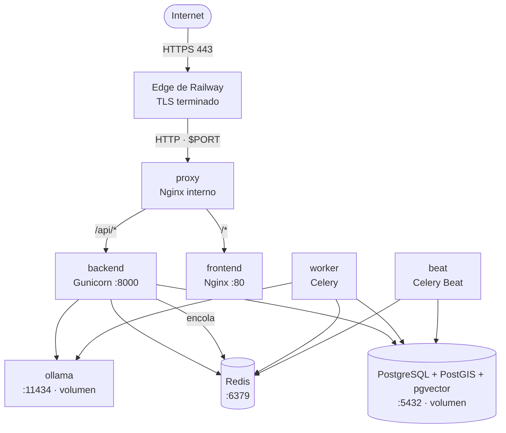

# Despliegue en Railway — guía completa

> **Estado:** Fase 1 (endpoint RAG), Fase 2 (imágenes GHCR) y Fase 3
> (proxy parametrizado + guía) implementadas en el repositorio. **No se ha
> desplegado nada**: el proyecto de Railway lo crea el propietario siguiendo
> esta guía.

## 1. Topología objetivo



- Solo **proxy** tiene dominio público. El resto vive en la red privada
  (`<servicio>.railway.internal`).
- Railway termina TLS en el edge: no hay certbot ni certificados en Nginx.
- Ollama es un servicio privado del mismo proyecto. No se expone a Internet.

## 2. Requisitos previos

| Requisito | Detalle |
|---|---|
| Plan | **Hobby** o superior. Free/Trial no alcanza para volúmenes de 5 GB. |
| Repositorio | `https://github.com/SajoriARA/proyecto-de-sistemas` |
| Imágenes | Publicadas en GHCR y **públicas** (ver §3). |
| Dominio | No hace falta dominio propio: se usa `https://<servicio>.up.railway.app`. |
| Modelos Ollama | `embeddinggemma:300m` (768 dimensiones) y `qwen3:0.6b`. |

## 3. Imágenes GHCR

| Imagen | Uso en Railway |
|---|---|
| `ghcr.io/sajoriara/proyecto-de-sistemas-backend:<tag>` | `backend`, `worker`, `beat` |
| `ghcr.io/sajoriara/proyecto-de-sistemas-frontend:<tag>` | `frontend` |
| `ghcr.io/sajoriara/proyecto-de-sistemas-proxy:latest` | `proxy` |
| `ghcr.io/sajoriara/proyecto-de-sistemas-db` | **No se usa**: Railway usa el template PostGIS + pgvector |

Publicación:

- Automática con un tag `v*.*.*` o manualmente con **Actions → Release →
  Run workflow** indicando una versión `X.Y.Z`.
- El workflow usa `GITHUB_TOKEN` con `packages: write`; no requiere secretos
  de Docker Hub.

**Paso obligatorio tras el primer release:** GitHub crea los paquetes como
privados. Abre cada paquete en **GitHub → Packages → Package settings →
Danger Zone → Change visibility → Public**. Sin esto, Railway Hobby no puede
descargar las imágenes.

En cada servicio de Railway, el origen se configura como **Docker Image** con
la referencia completa, por ejemplo:

```
ghcr.io/sajoriara/proyecto-de-sistemas-backend:1.0.9
```

Usa un tag semver o SHA para producción; `latest` solo para pruebas.

## 4. Matriz de servicios

Crea los servicios en este orden. Los nombres deben coincidir con los hosts
que usa el proxy.

| # | Servicio | Origen | Comando de arranque | Puerto interno | Público | Volumen |
|---|---|---|---|---|---|---|
| 1 | `db` | Template **PostGIS + pgvector** | el del template | `5432` | No | `/var/lib/postgresql/data` |
| 2 | `redis` | Template **Redis** | el del template | `6379` | No | `/data` (opcional) |
| 3 | `ollama` | Imagen `ollama/ollama:latest` | `ollama serve` | `11434` | No | `/root/.ollama` |
| 4 | `backend` | GHCR backend | el de la imagen (Gunicorn) | `8000` | No | — |
| 5 | `worker` | GHCR backend | `celery -A config worker --loglevel=info --concurrency=2` | — | No | — |
| 6 | `beat` | GHCR backend | `celery -A config beat --loglevel=info --scheduler django_celery_beat.schedulers:DatabaseScheduler` | — | No | — |
| 7 | `frontend` | GHCR frontend | el de la imagen (Nginx) | `80` | No | — |
| 8 | `proxy` | GHCR proxy | el de la imagen (Nginx) | `$PORT` | **Sí** | — |

> **No crees `flower`**: consume memoria y no es necesario para el
> despliegue público. Si lo quieres, queda privado y sin dominio.

### Nombres internos

Si Railway agrega un sufijo al nombre del servicio (por ejemplo
`backend-production`), usa el nombre exacto que muestra **Settings →
Networking → Private Networking**. El proxy recibe esos nombres por variable
de entorno; no están codificados en la imagen.

## 5. Variables por servicio

Railway comparte variables entre servicios si se definen como
*shared variables*. Las siguientes se pueden definir una vez y referenciar:

```dotenv
# Base de datos (template PostGIS + pgvector)
POSTGRES_DB=${{Postgres.POSTGRES_DB}}
POSTGRES_USER=${{Postgres.POSTGRES_USER}}
POSTGRES_PASSWORD=${{Postgres.POSTGRES_PASSWORD}}
POSTGRES_HOST=${{Postgres.RAILWAY_PRIVATE_DOMAIN}}
POSTGRES_PORT=5432

# Django
DJANGO_SECRET_KEY=<cadena-aleatoria-larga>
DJANGO_DEBUG=0
DJANGO_ALLOWED_HOSTS=<servicio-proxy>.up.railway.app
DJANGO_CSRF_TRUSTED_ORIGINS=https://<servicio-proxy>.up.railway.app
CORS_ALLOWED_ORIGINS=https://<servicio-proxy>.up.railway.app
DJANGO_SECURE_SSL_REDIRECT=0
DJANGO_NUM_PROXIES=2
SERVE_DOCS=0

# Celery
CELERY_BROKER_URL=redis://${{Redis.RAILWAY_PRIVATE_DOMAIN}}:6379/0
CELERY_RESULT_BACKEND=redis://${{Redis.RAILWAY_PRIVATE_DOMAIN}}:6379/0

# Ollama / RAG
OLLAMA_BASE_URL=http://${{ollama.RAILWAY_PRIVATE_DOMAIN}}:11434
OLLAMA_EMBED_MODEL=embeddinggemma:300m
OLLAMA_LLM_MODEL=qwen3:0.6b
EMBEDDING_DIM=768
RAG_TOP_K=4
RAG_UMBRAL=0.65
RAG_MAX_PREGUNTA=500
RAG_THROTTLE_ANON=10/minute
RAG_THROTTLE_USER=30/minute

# Cloudinary
CLOUDINARY_CLOUD_NAME=<cloud>
CLOUDINARY_API_KEY=<key>
CLOUDINARY_API_SECRET=<secret>
```

> `${{Postgres.RAILWAY_PRIVATE_DOMAIN}}` y `${{Redis.RAILWAY_PRIVATE_DOMAIN}}`
> son referencias de Railway. Si el template usa otro nombre de servicio,
> ajústalas. El backend lee `POSTGRES_HOST` y `POSTGRES_PORT`, no
> `DATABASE_URL`.

### `backend`

| Variable | Valor |
|---|---|
| `PORT` | `8000` (para que el healthcheck apunte al puerto correcto) |
| `DJANGO_ALLOWED_HOSTS` | dominio público del proxy |
| `DJANGO_CSRF_TRUSTED_ORIGINS` | `https://<dominio-proxy>` |
| `CORS_ALLOWED_ORIGINS` | `https://<dominio-proxy>` |
| `DJANGO_NUM_PROXIES` | `2` (edge de Railway + proxy) |
| `DJANGO_SECURE_SSL_REDIRECT` | `0` (el edge ya redirige; evita bucles) |
| `SERVE_DOCS` | `0` en producción |
| `OLLAMA_BASE_URL` | `http://<ollama>.railway.internal:11434` |
| `POSTGRES_*`, `CELERY_*`, `CLOUDINARY_*` | ver bloque compartido |

**Pre-deploy command:**

```bash
python manage.py migrate --noinput
```

Las migraciones deben correr en runtime (la red privada no existe durante el
build). No pongas `migrate` en `worker` ni en `beat`.

**Healthcheck:** `GET /api/health/` en el puerto `8000`.

### `worker` y `beat`

- Mismas variables que `backend` (incluido `POSTGRES_*`, `CELERY_*`,
  `OLLAMA_*` y `CLOUDINARY_*`).
- Sin `PORT`, sin dominio, sin healthcheck HTTP.
- `worker` necesita red hacia `db`, `redis` y `ollama`.
- `beat` necesita red hacia `db` y `redis`.

### `frontend`

- No necesita variables en runtime: la URL de la API (`VITE_API_URL=/api`) y
  el cloud de Cloudinary se compilan dentro del bundle.
- Si cambias `VITE_CLOUDINARY_CLOUD_NAME`, hay que **reconstruir y publicar**
  la imagen; no basta con cambiar la variable en Railway.
- Healthcheck: `GET /` en el puerto `80`.

### `proxy`

| Variable | Valor |
|---|---|
| `PORT` | lo inyecta Railway; **no lo sobrescribas** |
| `FRONTEND_HOST` | `<frontend>.railway.internal` |
| `FRONTEND_PORT` | `80` |
| `BACKEND_HOST` | `<backend>.railway.internal` |
| `BACKEND_PORT` | `8000` |
| `NGINX_RESOLVER` | `[fd12::10]` |

El proxy resuelve los upstreams **en tiempo de petición** con
`resolver ... valid=10s`. Así sigue funcionando cuando Railway cambia las IPs
tras un redespliegue. El healthcheck es `GET /healthz`.

> Si tu entorno es nuevo (posterior a octubre de 2025) y el DNS devuelve
> IPv4, `ipv6=on` sigue aceptando registros A. Si ves `no resolver defined`
> o `host not found`, revisa que `NGINX_RESOLVER` sea exactamente
> `[fd12::10]` (con corchetes) y que los hosts terminen en
> `.railway.internal`.

### `ollama`

| Variable | Valor |
|---|---|
| `OLLAMA_HOST` | `0.0.0.0:11434` |
| `OLLAMA_KEEP_ALIVE` | `24h` (opcional, evita recargar el modelo) |

- Volumen en `/root/.ollama` (modelos).
- Memoria recomendada: **4 GB** o más.
- Healthcheck: `GET /api/tags` en `11434`.

### `db` y `redis`

- Usa los templates; no cambies el comando de arranque.
- `db` necesita volumen persistente en `/var/lib/postgresql/data`.
- `redis` puede usar volumen en `/data` si quieres persistir la cola, aunque
  para una cola de Celery no es imprescindible.

## 6. Orden de creación

1. **Proyecto** → *New Project* → *Empty Project*. Nombre sugerido:
   `turismo-melgarejo`.
2. **PostgreSQL** → *Add* → *Database* → *PostGIS + pgvector* (template).
   Anota `POSTGRES_*` y `RAILWAY_PRIVATE_DOMAIN`.
3. **Redis** → *Add* → *Database* → *Redis*. Anota su dominio privado.
4. **Ollama** → *Add* → *Docker Image* →
   `ollama/ollama:latest`. Agrega volumen `/root/.ollama` y variables.
5. **backend** → *Docker Image* → GHCR backend. Configura variables,
   pre-deploy command y healthcheck. Despliega y espera a que esté *healthy*.
6. **worker** y **beat** → misma imagen, comandos de Celery. Sin dominio.
7. **frontend** → *Docker Image* → GHCR frontend. Sin dominio.
8. **proxy** → *Docker Image* → GHCR proxy. Agrega variables de hosts y
   genera el dominio público en *Settings → Networking → Public Networking*.
9. Ajusta `DJANGO_ALLOWED_HOSTS`, `DJANGO_CSRF_TRUSTED_ORIGINS` y
   `CORS_ALLOWED_ORIGINS` con el dominio real del proxy y **redespliega
   backend**.
10. Descarga los modelos de Ollama (§7).
11. Ejecuta las tareas de datos iniciales (§8) y las pruebas de humo (§9).

## 7. Descargar modelos en Ollama

Con el servicio `ollama` desplegado, abre una shell:

```bash
railway ssh --service ollama
ollama pull embeddinggemma:300m
ollama pull qwen3:0.6b
ollama list
```

Alternativa sin shell, usando un comando temporal en el servicio:

```bash
sh -c "ollama serve & sleep 5; ollama pull embeddinggemma:300m; ollama pull qwen3:0.6b; wait"
```

Vuelve al comando `ollama serve` cuando terminen las descargas. Los modelos
quedan en el volumen y sobreviven a los redespliegues.

## 8. Datos iniciales

Desde `railway ssh --service backend` (o `worker`, que tiene salida a
Internet y a Ollama):

```bash
# Migraciones (si no usaste pre-deploy)
python manage.py migrate --noinput

# Usuario administrador
python manage.py createsuperuser

# Scraping de fuentes autorizadas (requiere salida a Internet)
python manage.py scrape_fuentes

# Vectorización con embeddinggemma (requiere Ollama)
python manage.py vectorizar_fragmentos
```

> El scraping real necesita acceso saliente a los dominios configurados en
> `SCRAPER_ALLOWED_DOMAINS`. Si el servicio no tiene egress, ejecuta el
> scraping desde tu máquina y restaura el dump en Railway.

## 9. Pruebas de humo

Sustituye `<dominio>` por el dominio público del proxy.

```bash
# 1. Proxy vivo
curl -fsS https://<dominio>/healthz

# 2. Backend vivo (a través del proxy)
curl -fsS https://<dominio>/api/health/

# 3. OpenAPI (si SERVE_DOCS=1)
curl -fsS https://<dominio>/api/schema/ >/dev/null

# 4. RAG con contexto
curl -fsS -X POST https://<dominio>/api/conocimiento/consultar/ \
  -H 'Content-Type: application/json' \
  -d '{"pregunta":"¿Qué servicios sociales ofrece la Alcaldía de La Paz?","top_k":3}'

# 5. RAG sin contexto (debe responder la negativa estándar, sin citas)
curl -fsS -X POST https://<dominio>/api/conocimiento/consultar/ \
  -H 'Content-Type: application/json' \
  -d '{"pregunta":"¿Cuál es la capital de Francia?"}'

# 6. Throttle (ráfaga de 15 peticiones anónimas -> 429)
for i in $(seq 1 15); do
  curl -s -o /dev/null -w "%{http_code}\n" -X POST \
    https://<dominio>/api/conocimiento/consultar/ \
    -H 'Content-Type: application/json' \
    -d '{"pregunta":"prueba de throttle"}'
done
```

Resultados esperados:

- `/healthz` → `200 {"status":"ok","service":"proxy"}`.
- `/api/health/` → `200 {"status":"ok","service":"backend"}`.
- RAG con contexto → `200` con `respuesta`, `citas[]` y `recuperados > 0`.
- RAG sin contexto → `200` con `recuperados: 0`, `citas: []` y la negativa
  estándar.
- La ráfaga supera `RAG_THROTTLE_ANON` → `429`.

## 10. Backups

### Base de datos

```bash
# Desde tu máquina, con el proyecto enlazado
railway run --service db pg_dump -Fc -U "$POSTGRES_USER" "$POSTGRES_DB" \
  > backup-$(date +%F).dump
```

- Guarda el dump fuera de Railway (S3, disco local, etc.).
- Railway Hobby ofrece backups/snapshots del volumen; revisa la retención en
  *Volume → Backups*. No sustituyen un dump lógico propio.
- Prueba la restauración al menos una vez:

```bash
railway run --service db pg_restore -d "$POSTGRES_DB" --clean --if-exists backup.dump
```

### Ollama

Los modelos se pueden volver a descargar. No es necesario respaldar el
volumen de Ollama; solo ahorra tiempo de arranque.

## 11. Rollback

1. **Imagen anterior:** cambia el tag del servicio en *Settings → Source* al
   tag semver o SHA anterior (`1.0.8`, `1.0.7`, `<sha12>`) y pulsa
   **Deploy**. Railway no reutiliza el contenedor anterior: descarga la
   imagen indicada.
2. **Redespliegue rápido:** *Deployments → ⋯ → Redeploy* relanza el último
   despliegue sin cambiar la imagen.
3. **Base de datos:** si una migración es incompatible, restaura el dump
   previo antes de volver a la imagen anterior.
4. **Proxy:** el tag `latest` puede cambiar; para producción fija un tag
   semver del proxy cuando exista una versión estable.

## 12. Limitaciones y costes

- **Volúmenes:** 5 GB por volumen y 10 volúmenes en Hobby. `db` y `ollama`
  usan un volumen cada uno.
- **Réplicas:** un servicio con volumen no puede escalar horizontalmente.
  `db` y `ollama` tienen microcortes en cada redespliegue.
- **Memoria:** Ollama con `qwen3:0.6b` + `embeddinggemma:300m` necesita
  ~2–4 GB. Si el servicio se reinicia por OOM, sube el límite o usa un
  modelo más pequeño.
- **Egress:** el scraping y las descargas de modelos consumen salida a
  Internet. El tráfico interno entre servicios no se factura.
- **TLS:** lo termina Railway. No configures certbot ni el puerto 443 en
  Nginx.

## 13. Problemas frecuentes

| Síntoma | Causa probable | Solución |
|---|---|---|
| `502 Bad Gateway` en el proxy | El upstream no escucha en IPv6 o el host no resuelve | Verifica `listen [::]` en backend/frontend y `NGINX_RESOLVER=[fd12::10]`. |
| `host not found in upstream` | Se usó `upstream` estático en vez de variables | El template ya usa `set $backend_upstream ...`; no lo cambies a `upstream`. |
| `CSRF verification failed` | Falta el dominio en `DJANGO_CSRF_TRUSTED_ORIGINS` | Agrega `https://<dominio>` y redespliega backend. |
| `DisallowedHost` | Falta el dominio en `DJANGO_ALLOWED_HOSTS` | Agrega el dominio del proxy. |
| RAG responde `503` | Ollama no está listo o el modelo no existe | `railway ssh --service ollama`, `ollama list`, descarga el modelo. |
| RAG responde `502` | Ollama devolvió una respuesta inválida | Revisa logs del backend y del worker. |
| Worker no procesa tareas | `CELERY_BROKER_URL` incorrecto o Redis privado | Verifica el dominio privado de Redis y que `worker` tenga la variable. |
| Migraciones fallan en pre-deploy | La red privada no existe en build | Usa pre-deploy (runtime), no el build. |
| El frontend muestra 404 en rutas | Nginx no reescribe a `index.html` | La imagen ya incluye `try_files`; verifica que uses la imagen GHCR correcta. |
| Las imágenes no descargan | Paquete GHCR privado | Marca el paquete como **Public**. |

## 14. Relación con `deploy.yml`

`.github/workflows/deploy.yml` queda como **despliegue manual de respaldo
desde el código fuente** (`railway up`). No consume las imágenes de GHCR.

- Para el camino recomendado (imágenes GHCR), configura el origen *Docker
  Image* en cada servicio y usa **Deploy** o **Redeploy** desde Railway.
- Para el camino de respaldo, ejecuta **Actions → Deploy → Run workflow** y
  elige `source`.
- El despliegue automático por push queda desactivado a propósito: publicar
  una imagen y desplegarla son decisiones separadas.

## 15. Referencias

- [Red privada de Railway](https://docs.railway.com/networking/private-networking)
- [Cómo funciona la red privada](https://docs.railway.com/networking/private-networking/how-it-works)
- [Volúmenes de Railway](https://docs.railway.com/reference/volumes)
- [Healthchecks de Railway](https://docs.railway.com/reference/healthchecks)
- [Pre-deploy command](https://docs.railway.com/deployments/pre-deploy-command)
- [CLI de Railway](https://docs.railway.com/cli)
- [Template PostGIS + pgvector](https://railway.com/deploy/pg-postgis-and-pgvector)
