# Casos de Uso — Sistema Turístico La Paz

> Estado real del sistema: auth JWT con rotación, catálogo con filtros
> facetados y búsqueda geoespacial, administración de destinos y medios
> (Cloudinary + Celery), preferencias y consultas CRUD. El ranking de
> recomendaciones y el asistente RAG son Sprint 3 (`recommender.yml` es
> placeholder en CI).

```mermaid
flowchart TB
    subgraph Actores
        T[Turista]
        A[Administrador]
        S[Motor de Recomendación<br/>Sprint 3 · placeholder]
    end

    subgraph Cuenta
        UC1[UC-01: Registrarse<br/>rol TOURIST por defecto]
        UC2[UC-02: Iniciar Sesión<br/>access 30min + refresh 7d]
        UC3[UC-03: Cerrar Sesión<br/>blacklist del refresh]
        UC4[UC-04: Renovar Token<br/>rotación con blacklist]
        UC5[UC-05: Cambiar Contraseña]
        UC6[UC-06: Ver Perfil]
    end

    subgraph Catalogo["Catálogo público"]
        UC7[UC-07: Explorar Atractivos<br/>paginado 20]
        UC8[UC-08: Buscar y Filtrar<br/>q · categoria · zona · precio + facetas]
        UC9[UC-09: Ver Detalle de Atractivo<br/>fotos · tarifas · horarios · mapa]
        UC10[UC-10: Ver Atractivos Cercanos<br/>lat · lon · radio]
    end

    subgraph Preferencias
        UC11[UC-11: Gestionar Preferencias<br/>CRUD propio /api/preferences/]
    end

    subgraph Recomendaciones
        UC12[UC-12: Registrar Consulta<br/>presupuesto · tiempo · punto · macro]
        UC13[UC-13: Ver Historial de Consultas]
    end

    subgraph Administracion["Administración (solo ADMIN)"]
        UC14[UC-14: Gestionar Atractivos<br/>CRUD + baja lógica]
        UC15[UC-15: Gestionar Fotos<br/>firma directa + subida async + estado]
        UC16[UC-16: Gestionar Categorías]
        UC17[UC-17: Gestionar Horarios]
        UC18[UC-18: Gestionar Tarifas]
        UC19[UC-19: Gestionar Tipos de Tarifa]
        UC20[UC-20: Gestionar Fuentes Documentales]
        UC21[UC-21: Gestionar Fragmentos<br/>embedding solo escritura]
        UC22[UC-22: Listar Usuarios]
    end

    T --> UC1
    T --> UC2
    T --> UC3
    T --> UC4
    T --> UC5
    T --> UC6
    T --> UC7
    T --> UC8
    T --> UC9
    T --> UC10
    T --> UC11
    T --> UC12
    T --> UC13

    A --> UC2
    A --> UC3
    A --> UC4
    A --> UC5
    A --> UC6
    A --> UC7
    A --> UC8
    A --> UC9
    A --> UC10
    A --> UC11
    A --> UC12
    A --> UC13
    A --> UC14
    A --> UC15
    A --> UC16
    A --> UC17
    A --> UC18
    A --> UC19
    A --> UC20
    A --> UC21
    A --> UC22

    UC12 -.->|ranking Sprint 3| S
    S -.->|top N futuro| UC12
```

