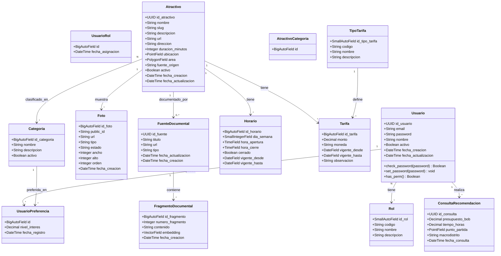
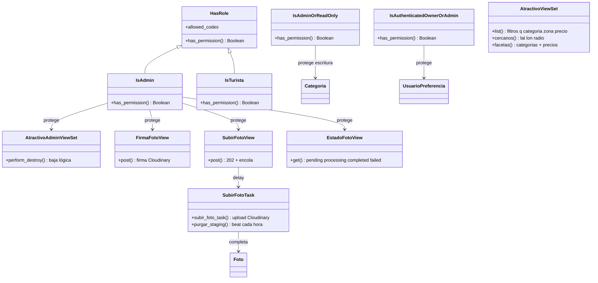

# Diagrama de Clases — Sistema Turístico La Paz

> Refleja los modelos Django reales (`db_table` legado en español).
> `Foto` solo guarda referencias Cloudinary (sin binarios en PG) con
> máquina de estados `pending → processing → completed/failed`.

## Capa API — políticas y vistas

