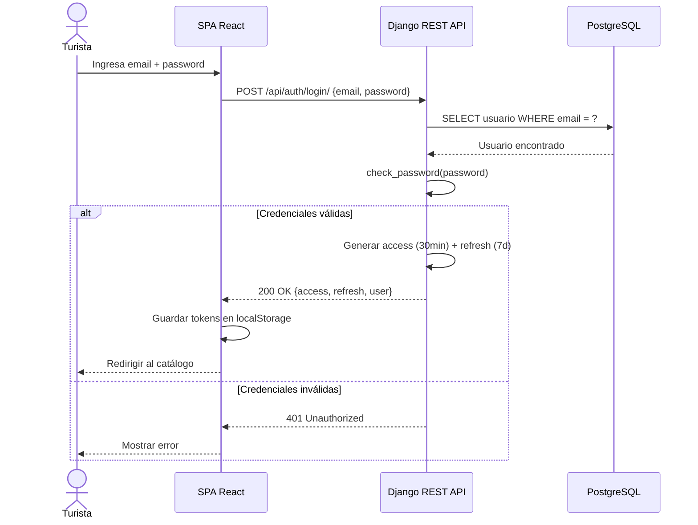
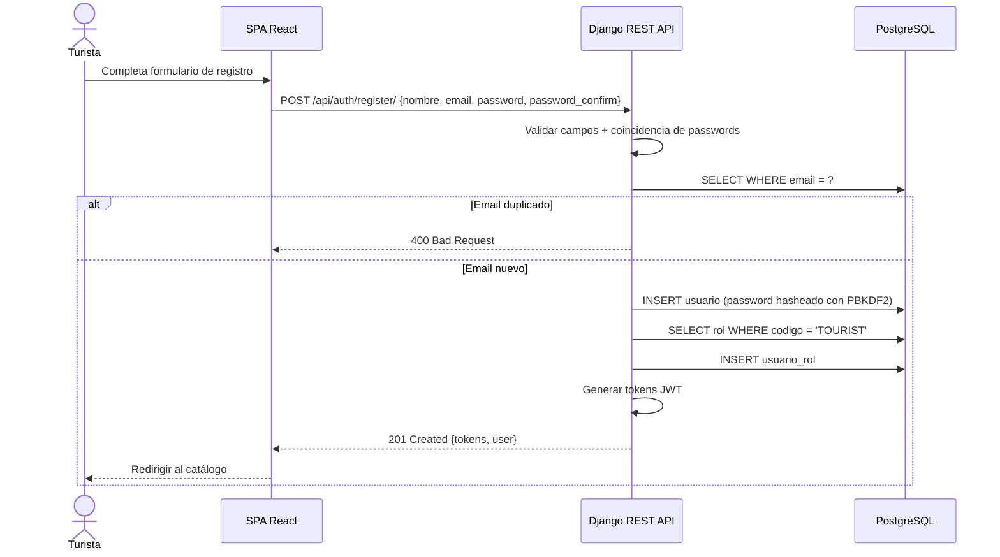
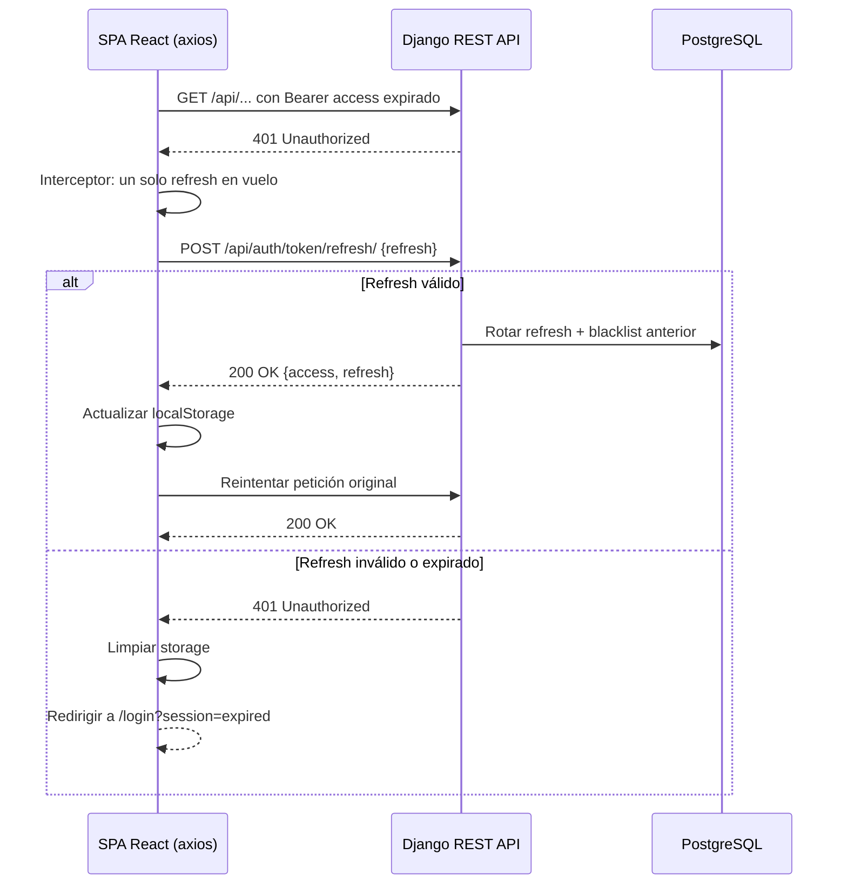
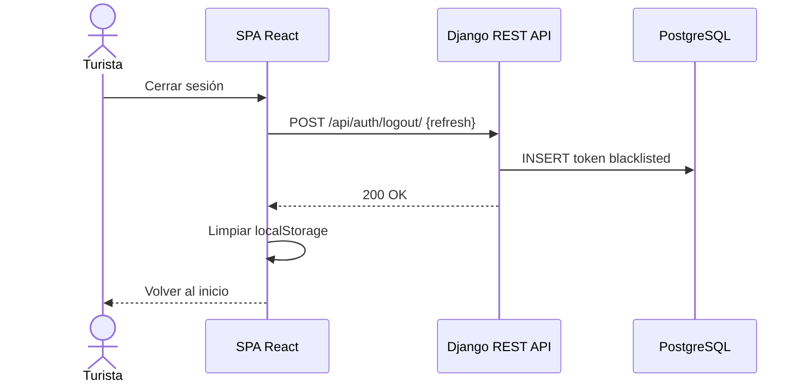
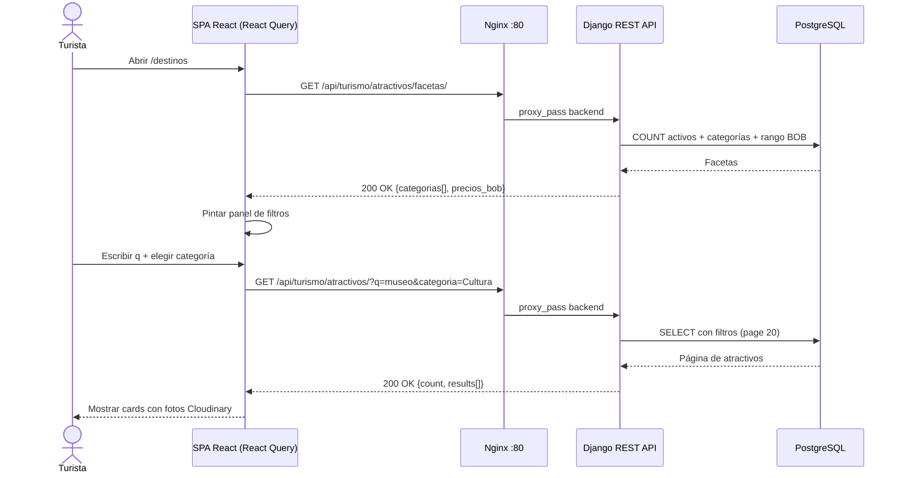
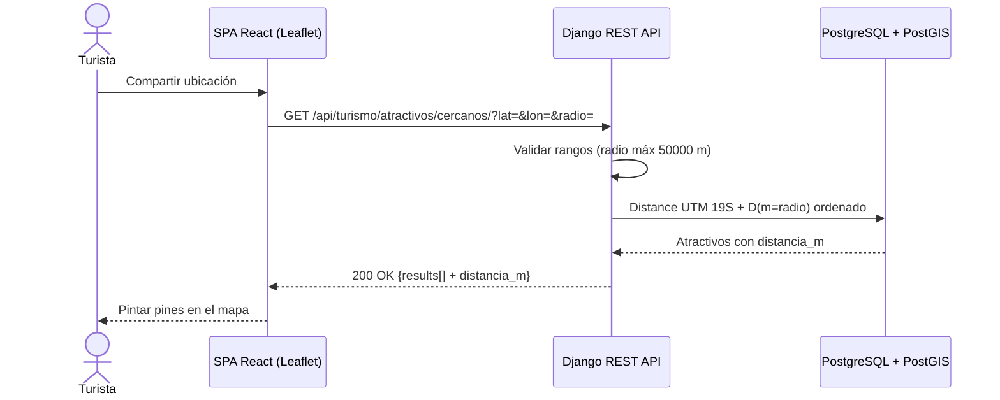
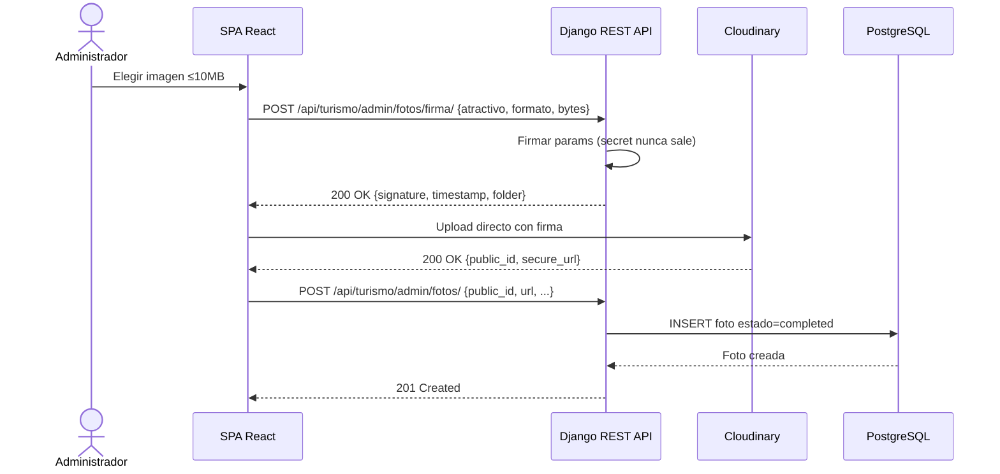
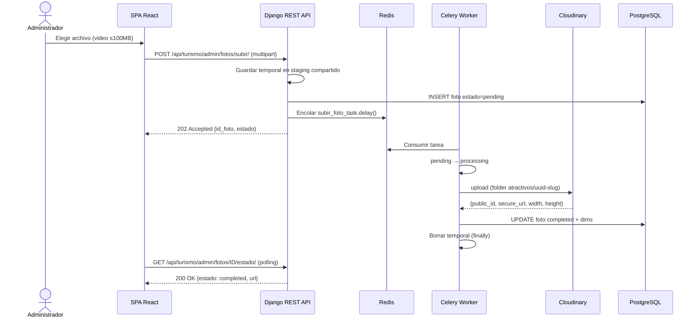
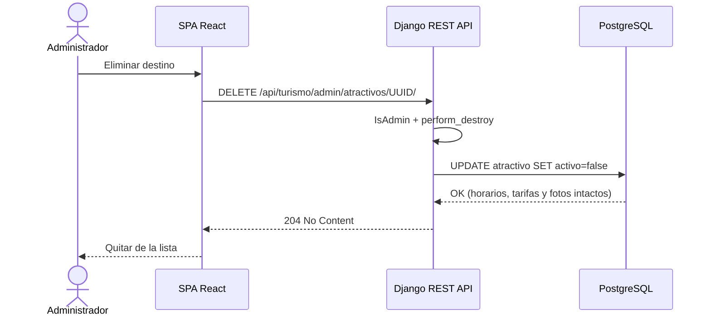
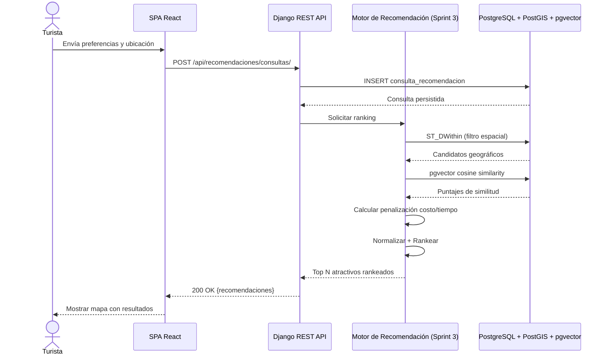

# Diagrama de Secuencia — Login JWT

# Diagrama de Secuencia — Registro con Rol TOURIST

# Diagrama de Secuencia — Renovación automática del token

# Diagrama de Secuencia — Logout con blacklist

# Diagrama de Secuencia — Catálogo con filtros y facetas

# Diagrama de Secuencia — Atractivos cercanos

# Diagrama de Secuencia — Subida directa firmada (imágenes)

# Diagrama de Secuencia — Subida async con Celery (pesados/video)

# Diagrama de Secuencia — Baja lógica de atractivo

# Diagrama de Secuencia — Solicitud de Recomendación (diseño objetivo Sprint 3)

> Hoy solo se persiste la consulta (`POST /api/recomendaciones/consultas/`
> y `/api/preferences/`). El ranking con PostGIS + pgvector y el
> asistente RAG son Sprint 3 (issues #26–#29). Este diagrama es el
> contrato a implementar, no el comportamiento actual.

