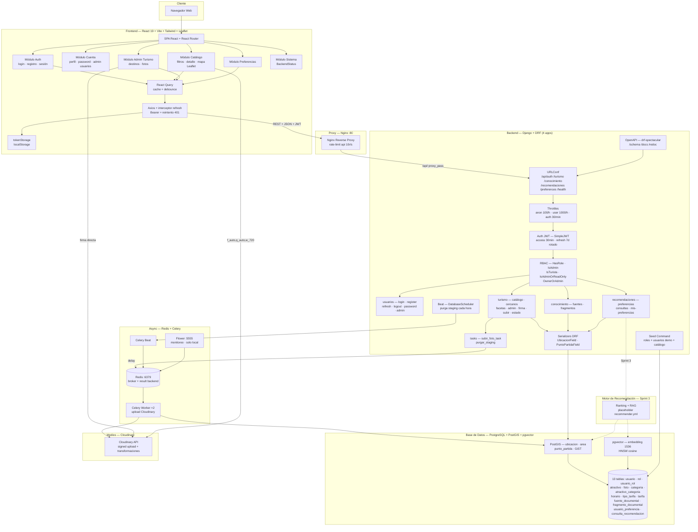

# Diagrama de Componentes — Sistema Turístico La Paz

> Estado real: SPA React con Leaflet + axios con interceptor de refresh y
> React Query; backend Django + DRF en 4 apps con RBAC por roles; medios
> en Cloudinary (directo + Celery async); docs OpenAPI con drf-spectacular.
> El motor de recomendación y el asistente RAG son Sprint 3.

