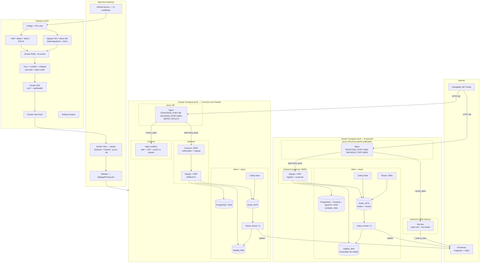

# Diagrama de Despliegue — Sistema Turístico La Paz

> Local: 8 servicios (`docker-compose.yml`) con runserver + Vite dev.
> Producción: 7 servicios (`docker-compose.prod.yml`, sin Flower) con
> gunicorn + frontend estático. Solo el puerto 80 se publica.

