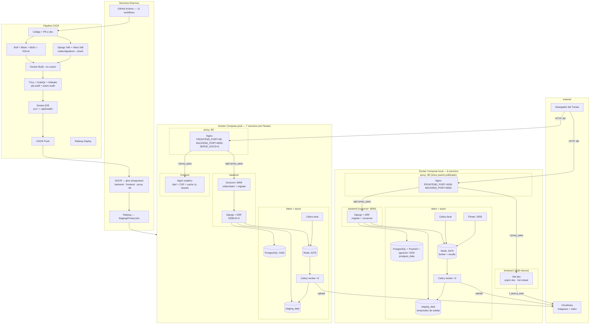
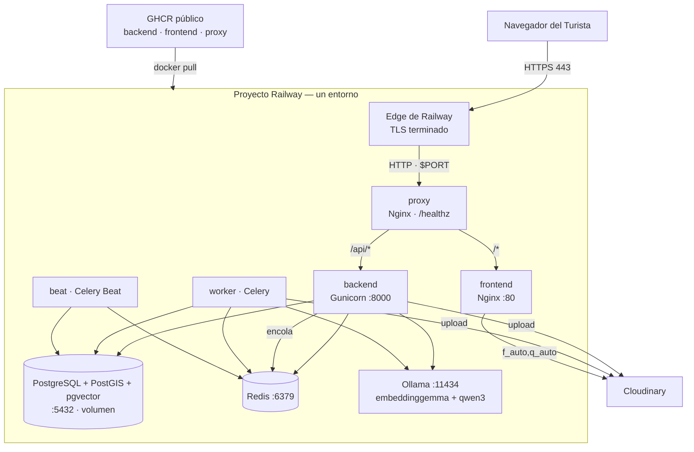

# Diagrama de Despliegue — Sistema Turístico La Paz

> Local: 8 servicios (`docker-compose.yml`) con runserver + Vite dev.
> Producción en VPS: 7 servicios (`docker-compose.prod.yml`, sin Flower) con
> gunicorn + frontend estático. Solo el puerto 80 se publica.
> Producción en Railway (PaaS): 8 servicios con imágenes GHCR, TLS en el
> edge y Ollama privado. Ver §PaaS al final.

## PaaS: Railway

> Topología del despliegue público. Solo `proxy` tiene dominio; el resto usa
> la red privada `<servicio>.railway.internal` (IPv6 o dual-stack).

Notas de despliegue:

- **TLS:** lo termina Railway. No hay certbot ni puerto 443 en Nginx.
- **Proxy:** escucha en `$PORT`, resuelve `frontend`/`backend` en tiempo de
  petición con `resolver [fd12::10]` y reenvía `X-Forwarded-For`.
- **Backend/frontend:** escuchan en dual-stack (`[::]`) para ser alcanzables
  por la red privada.
- **Django:** `DJANGO_NUM_PROXIES=2` (edge + proxy),
  `DJANGO_SECURE_SSL_REDIRECT=0` y `SERVE_DOCS=0`.
- **Migraciones:** pre-deploy command del servicio `backend`
  (`python manage.py migrate --noinput`), no en build.
- **Ollama:** servicio privado con volumen `/root/.ollama`; los modelos se
  descargan una vez y sobreviven a los redespliegues.
- **Imágenes:** `ghcr.io/sajoriara/proyecto-de-sistemas-*`; la base de datos
  usa el template PostGIS + pgvector, no la imagen `db`.

Guía operativa completa: [`deploy/railway/README.md`](../../deploy/railway/README.md).
