# Diagrama de Base de Datos — Modelo de Entidad Relación

> Fuente de verdad: modelos Django (`db_table` en español, PK sintéticas
> donde Django no soporta compuestas). `foto` guarda solo referencias
> Cloudinary con estados `pending → processing → completed/failed`.

```mermaid
erDiagram
    USUARIO {
        uuid id_usuario PK
        varchar email UK
        varchar password_hash
        varchar nombre
        boolean activo
        timestamp fecha_creacion
        timestamp fecha_actualizacion
    }

    ROL {
        smallint id_rol PK
        varchar codigo UK "ADMIN · TOURIST"
        varchar nombre
        varchar descripcion "nullable"
    }

    USUARIO_ROL {
        bigint id PK
        uuid id_usuario FK
        smallint id_rol FK
        timestamp fecha_asignacion
    }

    CATEGORIA {
        bigint id_categoria PK
        varchar nombre UK
        text descripcion "nullable"
        boolean activo
    }

    ATRACTIVO {
        uuid id_atractivo PK
        varchar nombre
        varchar slug
        text descripcion
        varchar url "nullable"
        varchar direccion "nullable"
        integer duracion_minutos "nullable"
        geometry_Point_4326 ubicacion
        geometry_Polygon_4326 area "nullable"
        varchar fuente_origen "default INSTITUCIONAL"
        boolean activo
        timestamp fecha_creacion
        timestamp fecha_actualizacion
    }

    FOTO {
        bigint id_foto PK
        uuid id_atractivo FK
        varchar public_id UK
        varchar url
        varchar tipo "imagen · video"
        varchar estado "pending · processing · completed · failed"
        integer ancho "nullable"
        integer alto "nullable"
        integer orden
        timestamp fecha_creacion
    }

    ATRACTIVO_CATEGORIA {
        bigint id PK
        uuid id_atractivo FK
        bigint id_categoria FK
    }

    HORARIO {
        bigint id_horario PK
        uuid id_atractivo FK
        smallint dia_semana
        time hora_apertura "nullable"
        time hora_cierre "nullable"
        boolean cerrado
        date vigente_desde "nullable"
        date vigente_hasta "nullable"
    }

    TIPO_TARIFA {
        smallint id_tipo_tarifa PK
        varchar codigo UK
        varchar nombre
        varchar descripcion "nullable"
    }

    TARIFA {
        bigint id_tarifa PK
        uuid id_atractivo FK
        smallint id_tipo_tarifa FK
        decimal monto
        varchar moneda "default BOB"
        date vigente_desde "nullable"
        date vigente_hasta "nullable"
        varchar observacion "nullable"
    }

    FUENTE_DOCUMENTAL {
        uuid id_fuente PK
        uuid id_atractivo FK "nullable, SET NULL"
        varchar titulo
        text url "nullable"
        varchar tipo "nullable"
        timestamp fecha_actualizacion "nullable"
        timestamp fecha_creacion
    }

    FRAGMENTO_DOCUMENTAL {
        bigint id_fragmento PK
        uuid id_fuente FK
        integer numero_fragmento
        text contenido
        vector_1536 embedding
        timestamp fecha_creacion
    }

    USUARIO_PREFERENCIA {
        bigint id PK
        uuid id_usuario FK
        bigint id_categoria FK
        decimal nivel_interes "default 1.00"
        timestamp fecha_registro
    }

    CONSULTA_RECOMENDACION {
        uuid id_consulta PK
        uuid id_usuario FK "nullable, SET NULL"
        decimal presupuesto_bob
        decimal tiempo_horas
        geometry_Point_4326 punto_partida
        varchar macrodistrito "nullable"
        timestamp fecha_consulta
    }

    USUARIO ||--o{ USUARIO_ROL : "tiene"
    ROL ||--o{ USUARIO_ROL : "asignado_a"
    USUARIO ||--o{ USUARIO_PREFERENCIA : "posee"
    USUARIO ||--o{ CONSULTA_RECOMENDACION : "realiza"
    CATEGORIA ||--o{ ATRACTIVO_CATEGORIA : "clasifica"
    ATRACTIVO ||--o{ ATRACTIVO_CATEGORIA : "clasificado_en"
    ATRACTIVO ||--o{ HORARIO : "tiene"
    ATRACTIVO ||--o{ TARIFA : "tiene"
    ATRACTIVO ||--o{ FOTO : "muestra"
    ATRACTIVO ||--o{ FUENTE_DOCUMENTAL : "documentado_por"
    TIPO_TARIFA ||--o{ TARIFA : "define"
    FUENTE_DOCUMENTAL ||--o{ FRAGMENTO_DOCUMENTAL : "contiene"
    CATEGORIA ||--o{ USUARIO_PREFERENCIA : "preferida_en"

    %% Constraints reales (nombre en migración)
    %% USUARIO_ROL: UNIQUE(usuario, rol) → pk_usuario_rol
    %% ATRACTIVO: CHECK NULL OR duracion_minutos > 0 → ck_atractivo_duracion
    %% ATRACTIVO_CATEGORIA: UNIQUE(atractivo, categoria) → pk_atractivo_categoria
    %% FOTO: CHECK(orden >= 0) → ck_foto_orden
    %% HORARIO: CHECK(dia_semana BETWEEN 1 AND 7) → ck_horario_dia
    %% HORARIO: CHECK(cerrado OR (apertura NOT NULL AND cierre NOT NULL AND apertura < cierre)) → ck_horario_horas
    %% HORARIO: CHECK(vigencia coherente) → ck_horario_vigencia
    %% TARIFA: CHECK(monto >= 0) → ck_tarifa_monto
    %% TARIFA: CHECK(vigencia coherente) → ck_tarifa_vigencia
    %% FRAGMENTO_DOCUMENTAL: UNIQUE(fuente, numero_fragmento) → uq_fragmento_fuente_numero
    %% FRAGMENTO_DOCUMENTAL: CHECK(numero_fragmento >= 0) → ck_fragmento_numero
    %% USUARIO_PREFERENCIA: UNIQUE(usuario, categoria) → pk_usuario_preferencia
    %% USUARIO_PREFERENCIA: CHECK(nivel_interes BETWEEN 0 AND 1) → ck_usuario_preferencia_nivel
    %% CONSULTA_RECOMENDACION: CHECK(presupuesto_bob >= 0) → ck_consulta_presupuesto
    %% CONSULTA_RECOMENDACION: CHECK(tiempo_horas > 0) → ck_consulta_tiempo

    %% Índices reales (nombre en migración)
    %% USUARIO_ROL: Index(rol) → idx_usuario_rol_rol
    %% ATRACTIVO: GiST(ubicacion) → idx_atractivo_ubicacion_gist
    %% ATRACTIVO: GiST(area) → idx_atractivo_area_gist
    %% ATRACTIVO_CATEGORIA: Index(categoria) → idx_atractivo_cat_cat
    %% FOTO: Index(atractivo, orden) → idx_foto_atractivo_orden
    %% HORARIO: Index(atractivo, dia_semana) → idx_horario_atractivo_dia
    %% TARIFA: Index(atractivo) → idx_tarifa_atractivo
    %% TARIFA: Index(atractivo, monto) → idx_tarifa_atractivo_monto
    %% TARIFA: Index(tipo_tarifa) → idx_tarifa_tipo
    %% FUENTE_DOCUMENTAL: Index(atractivo) → idx_fuente_doc_atractivo
    %% FRAGMENTO_DOCUMENTAL: HNSW(embedding, vector_cosine_ops) → idx_fragmento_embedding_hnsw
    %% USUARIO_PREFERENCIA: Index(categoria) → idx_upref_categoria
    %% CONSULTA_RECOMENDACION: Index(usuario) → idx_consulta_usuario
    %% CONSULTA_RECOMENDACION: GiST(punto_partida) → idx_consulta_punto_partida_gist
```

